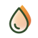
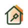
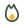
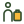
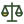
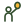
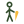
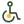
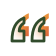

# Бренд-кіт Благодійного фонду «Стабілізейшен Суппорт Сервісез»

Логотипи (зокрема CMYK для друку), кольори, шрифти, 65 фірмових іконок, конструктори дописів і графіків, шаблони Canva, PowerPoint і Excel, веб-набір для WordPress, анімація логотипа. Повні правила — у [брендбуку](brandbook.html) ([PDF](docs/SSS_Brandbook_2.0.pdf)), коротко — у [шпаргалці на одну сторінку](docs/SSS_shpargalka.pdf).

## Сайт бренд-кіту

Відкрийте `index.html` або увімкніть GitHub Pages: **Settings → Pages → Build and deployment → Deploy from a branch → `main` / `(root)`**. Через хвилину сайт буде доступний за адресою `https://<організація>.github.io/<репозиторій>/`.

На сайті:

- **Короткий старт** — 10 головних правил і шпаргалка PDF.
- **Логотип** — оберіть версію і фон, завантажте SVG або PNG у правильному кольорі; файли для друку (CMYK PDF, EPS) і оригінали від дизайнера.
- **Кольори** — копіювання HEX у клік, перевірка контрасту.
- **Шрифти** — завантаження TTF, перевірка власного тексту.
- **Іконки** — пошук, кольорові схеми, копіювання SVG для Figma, PNG 512 px для Canva.
- **Конструктор дописів** — 6 макетів × 5 форматів, градієнти, своє фото, кілька логотипів у потрібному порядку або готова плашка донора, експорт PNG.
- **Інфографіка** — порядок кольорів для рядів даних, конструктор графіків (смуги, стовпчики, кільце, велике число) → PNG, шаблон Excel з фірмовою темою, тема для Google Таблиць.
- **Сайт** — CSS-змінні, кнопки, посилання, картки, мітки для WordPress.
- **Відео** — анімація логотипа 1,5 с: MP4 16:9 і 9:16, MOV з прозорістю.
- **Canva і шаблони** — Brand Kit, Canva for Nonprofits, спільні шаблони; 44 PDF-шаблони для першого налаштування; шаблон презентації .pptx.
- **Назва фонду** — правильна форма назви для кожного випадку.
- **Перед публікацією** — генератор назви файлу і чекліст.

## Структура

```
index.html            сайт бренд-кіту
brandbook.html        повний брендбук
docs/                 брендбук PDF, шпаргалка PDF
logo/svg, logo/png    логотип UA, EN, символ × 6 кольорів (original #214E34, Ліс, Молоко, Глибина, білий, чорний)
logo/print            CMYK PDF і EPS для друку (зелений CMYK 91·40·86·44, білий, чорний)
logo/original         оригінальні векторні файли від дизайнера
icons/svg             іконки «скло» (від 40 px)
icons/svg-flat        плоскі іконки для дрібних розмірів
icons/svg-mono        іконки currentColor (для коду і Figma)
icons/png             іконки 512 px з прозорим фоном (Canva)
icons/sprite.svg      SVG-спрайт для сайту
icons/icons.json      список іконок з назвами і групами
colors/               palette.json, colors.css, _colors.scss, кольори для Canva
fonts/                Manrope, Onest (TTF, ліцензія OFL)
templates/canva       44 шаблони PDF для імпорту в Canva
templates/pptx        шаблон презентації 16:9 з фірмовою темою
charts/               шаблон Excel з темою і діаграмами, theme1.xml
web/                  sss-web.css, theme.json для WordPress, приклад demo.html
video/                анімація логотипа MP4 і MOV з прозорістю
templates/preview     прев’ю шаблонів PNG
sss-brand-kit.zip     усі файли одним архівом
```

## Canva

1. Командний акаунт фонду — через Canva for Nonprofits.
2. **Brand Kit:** логотипи з `logo/`, кольори з `colors/canva-brand-kit.txt`, шрифти з `fonts/`.
3. Шаблони рубрик створюємо один раз, публікуємо в команді як шаблони бренду і ділимося посиланнями.
4. PDF з `templates/canva/` — лише для першого створення шаблону: після імпорту перевірте шрифти й відстані.

## Сайт (WordPress)

- Класична тема: **Вигляд → Налаштувати → Додатковий CSS** → вставте `web/sss-web.css`.
- Блокова тема: перенесіть `web/theme.json` у дочірню тему.
- Кнопки: класи `sss-btn sss-btn--primary | --secondary | --outline`; картки `sss-card`; мітки `sss-chip`.

## Друк

| Колір | HEX | CMYK | Pantone | RAL |
|---|---|---|---|---|
| Зелений логотипа | `#214E34` | 91·40·86·44 | 3435 C | 6005 |
| Ліс | `#314C2C` | 75·45·85·50 | 350 C | 6002 |
| Глибина | `#1B2A18` | 80·55·90·70 | Black 3 C | 6009 |
| Молоко | `#FBF6EC` | 0·2·6·1 | — | 9001 |
| Соняшник | `#F6B93B` | 0·30·85·0 | 7409 C | 1028 |
| Теракота | `#DC643D` | 5·72·85·0 | 7578 C | 2010 |
| Паросток | `#A9D48E` | 38·0·55·0 | 358 C | 6019 |
| Небо | `#D7E6FB` | 15·5·0·0 | 656 C | — |
| Камінь | `#66705F` | 55·40·60·30 | 417 C | 7009 |
| Пісок | `#E6DFD0` | 8·10·18·0 | 7527 C | 1013 |

Точний лише зелений логотипа; решта — найближчі відповідники, перед тиражем просіть пробний відбиток.

## Іконки

- Figma: відкрийте SVG у браузері, скопіюйте код і вставте в Figma (Ctrl+V) — або натисніть «Копіювати SVG» на сайті.
- Canva: **Завантаження → Завантажити файли** → PNG або SVG з `icons/`.
- HTML: `<svg width="24" height="24"><use href="icons/sprite.svg#sss-home"/></svg>`; кольори задаються змінними `--icon-line` і `--icon-accent`.

Стиль «скло»: кольорова задня форма (градієнт Соняшник → Теракота), матове скло спереду і контур деталей 1,4 px. Від 40 px. Для дрібних розмірів — плоский дуотон (`icons/svg-flat`). Нові іконки малюємо за цими параметрами (див. брендбук, розділ «Іконки»).

## Кольори

| Колір | HEX | Роль |
|---|---|---|
| Ліс | `#314C2C` | Ключовий |
| Молоко | `#FBF6EC` | Базовий фон |
| Глибина | `#1B2A18` | Текст |
| Соняшник | `#F6B93B` | Акцент · допомога |
| Теракота | `#DC643D` | Акцент · терміново |
| Паросток | `#A9D48E` | Акцент · громади |
| Небо | `#D7E6FB` | Акцент · права |
| Камінь | `#66705F` | Другорядний текст |
| Пісок | `#E6DFD0` | Лінії |

## Іконки

### Гуманітарне реагування

| | Назва | Файл |
|---|---|---|
|  | Гуманітарна допомога | [`aid.svg`](icons/svg/aid.svg) · [png](icons/png/aid.png) |
|  | Продуктовий набір | [`food.svg`](icons/svg/food.svg) · [png](icons/png/food.png) |
|  | Гігієнічний набір | [`hygiene.svg`](icons/svg/hygiene.svg) · [png](icons/png/hygiene.png) |
|  | Медичний набір | [`med.svg`](icons/svg/med.svg) · [png](icons/png/med.png) |
|  | Непродовольчі товари (НПД) | [`nfi.svg`](icons/svg/nfi.svg) · [png](icons/png/nfi.png) |
|  | Питна вода | [`water.svg`](icons/svg/water.svg) · [png](icons/png/water.png) |
|  | WASH / водопостачання | [`wash.svg`](icons/svg/wash.svg) · [png](icons/png/wash.png) |
|  | Соціальна пральня | [`laundry.svg`](icons/svg/laundry.svg) · [png](icons/png/laundry.png) |
|  | Житло | [`home.svg`](icons/svg/home.svg) · [png](icons/png/home.png) |
|  | Ремонт житла | [`repair.svg`](icons/svg/repair.svg) · [png](icons/png/repair.png) |
|  | Будматеріали | [`bricks.svg`](icons/svg/bricks.svg) · [png](icons/png/bricks.png) |
|  | Енергостійкість | [`energy.svg`](icons/svg/energy.svg) · [png](icons/png/energy.png) |
|  | Обігрів | [`heat.svg`](icons/svg/heat.svg) · [png](icons/png/heat.png) |
|  | Паливо | [`fuel.svg`](icons/svg/fuel.svg) · [png](icons/png/fuel.png) |
|  | Зимова допомога | [`winter.svg`](icons/svg/winter.svg) · [png](icons/png/winter.png) |
|  | Грошова допомога | [`cash.svg`](icons/svg/cash.svg) · [png](icons/png/cash.png) |
|  | Доставка | [`truck.svg`](icons/svg/truck.svg) · [png](icons/png/truck.png) |
|  | Логістика / склад | [`boxes.svg`](icons/svg/boxes.svg) · [png](icons/png/boxes.png) |

### Захист і ВПО

| | Назва | Файл |
|---|---|---|
|  | ВПО | [`idp.svg`](icons/svg/idp.svg) · [png](icons/png/idp.png) |
|  | Ради та обговорення | [`council.svg`](icons/svg/council.svg) · [png](icons/png/council.png) |
|  | Гаряча лінія | [`hotline.svg`](icons/svg/hotline.svg) · [png](icons/png/hotline.png) |
|  | Правова допомога | [`legal.svg`](icons/svg/legal.svg) · [png](icons/png/legal.png) |
|  | Консультація | [`consult.svg`](icons/svg/consult.svg) · [png](icons/png/consult.png) |
|  | Документи | [`docs.svg`](icons/svg/docs.svg) · [png](icons/png/docs.png) |
|  | Скарги та пропозиції | [`feedback.svg`](icons/svg/feedback.svg) · [png](icons/png/feedback.png) |
|  | Психосоціальна підтримка | [`psy.svg`](icons/svg/psy.svg) · [png](icons/png/psy.png) |
|  | Захист | [`shield.svg`](icons/svg/shield.svg) · [png](icons/png/shield.png) |
|  | Діти | [`kids.svg`](icons/svg/kids.svg) · [png](icons/png/kids.png) |
|  | Літні люди | [`elderly.svg`](icons/svg/elderly.svg) · [png](icons/png/elderly.png) |
|  | Люди з інвалідністю | [`access.svg`](icons/svg/access.svg) · [png](icons/png/access.png) |
|  | Гендерна рівність | [`equal.svg`](icons/svg/equal.svg) · [png](icons/png/equal.png) |

### Громади і розвиток

| | Назва | Файл |
|---|---|---|
|  | Громада | [`community.svg`](icons/svg/community.svg) · [png](icons/png/community.png) |
|  | Розвиток громад | [`sprout.svg`](icons/svg/sprout.svg) · [png](icons/png/sprout.png) |
|  | Освіта і тренінги | [`edu.svg`](icons/svg/edu.svg) · [png](icons/png/edu.png) |
|  | Гейміфікація | [`game.svg`](icons/svg/game.svg) · [png](icons/png/game.png) |
|  | Молодь та ідеї | [`idea.svg`](icons/svg/idea.svg) · [png](icons/png/idea.png) |
|  | Медіаграмотність | [`media.svg`](icons/svg/media.svg) · [png](icons/png/media.png) |
|  | Адвокація | [`advocacy.svg`](icons/svg/advocacy.svg) · [png](icons/png/advocacy.png) |
|  | Закон і законодавство | [`law.svg`](icons/svg/law.svg) · [png](icons/png/law.png) |
|  | Партнерство | [`partner.svg`](icons/svg/partner.svg) · [png](icons/png/partner.png) |
|  | Державні установи | [`gov.svg`](icons/svg/gov.svg) · [png](icons/png/gov.png) |
|  | Фахівці соцзахисту | [`pro.svg`](icons/svg/pro.svg) · [png](icons/png/pro.png) |
|  | Волонтерство | [`volunteer.svg`](icons/svg/volunteer.svg) · [png](icons/png/volunteer.png) |
|  | Підтримати фонд | [`donate.svg`](icons/svg/donate.svg) · [png](icons/png/donate.png) |
|  | Вакансії та тендери | [`jobs.svg`](icons/svg/jobs.svg) · [png](icons/png/jobs.png) |

### Службові

| | Назва | Файл |
|---|---|---|
|  | Онлайн-подія | [`online.svg`](icons/svg/online.svg) · [png](icons/png/online.png) |
|  | Відео | [`video.svg`](icons/svg/video.svg) · [png](icons/png/video.png) |
|  | Цитата | [`quote.svg`](icons/svg/quote.svg) · [png](icons/png/quote.png) |
|  | Субтитри | [`subs.svg`](icons/svg/subs.svg) · [png](icons/png/subs.png) |
|  | Локація | [`pin.svg`](icons/svg/pin.svg) · [png](icons/png/pin.png) |
|  | Дата | [`cal.svg`](icons/svg/cal.svg) · [png](icons/png/cal.png) |
|  | Час | [`clock.svg`](icons/svg/clock.svg) · [png](icons/png/clock.png) |
|  | Подія / форум | [`event.svg`](icons/svg/event.svg) · [png](icons/png/event.png) |
|  | Звіт | [`report.svg`](icons/svg/report.svg) · [png](icons/png/report.png) |
|  | Аналітика | [`chart.svg`](icons/svg/chart.svg) · [png](icons/png/chart.png) |
|  | Зростання | [`growth.svg`](icons/svg/growth.svg) · [png](icons/png/growth.png) |
|  | Увага / екстрено | [`alert.svg`](icons/svg/alert.svg) · [png](icons/png/alert.png) |
|  | Інформація | [`info.svg`](icons/svg/info.svg) · [png](icons/png/info.png) |
|  | Питання | [`faq.svg`](icons/svg/faq.svg) · [png](icons/png/faq.png) |
|  | Виконано | [`done.svg`](icons/svg/done.svg) · [png](icons/png/done.png) |
|  | Телефон | [`phone.svg`](icons/svg/phone.svg) · [png](icons/png/phone.png) |
|  | Пошта | [`mail.svg`](icons/svg/mail.svg) · [png](icons/png/mail.png) |
|  | Сайт | [`web.svg`](icons/svg/web.svg) · [png](icons/png/web.png) |
|  | Дякуємо | [`heart.svg`](icons/svg/heart.svg) · [png](icons/png/heart.png) |
|  | Стрілка / далі | [`arrow.svg`](icons/svg/arrow.svg) · [png](icons/png/arrow.png) |

## Ліцензії

- Логотип, іконки, шаблони і брендбук — власність БФ «ССС». Використання — лише для матеріалів фонду та його партнерів.
- Шрифти Manrope і Onest — SIL Open Font License 1.1 (`fonts/*/OFL.txt`).

Питання щодо бренду: info@sss-ua.org
